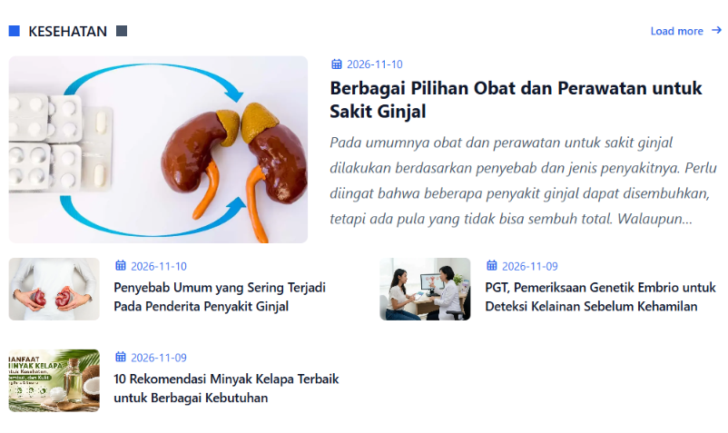
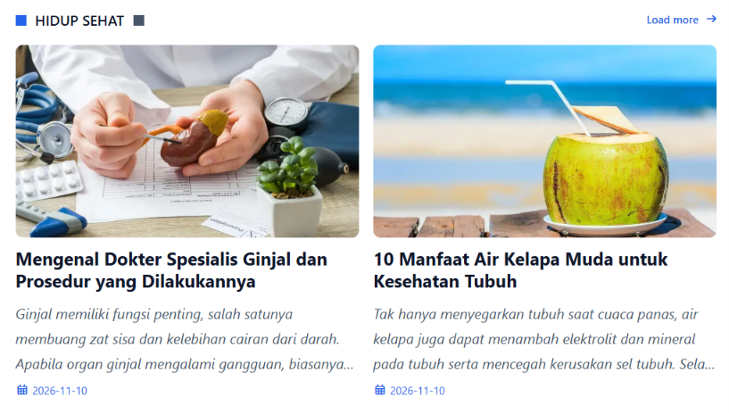
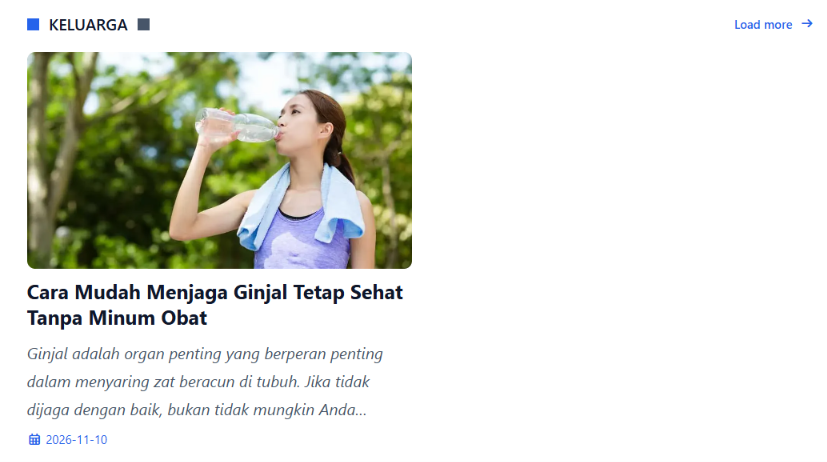
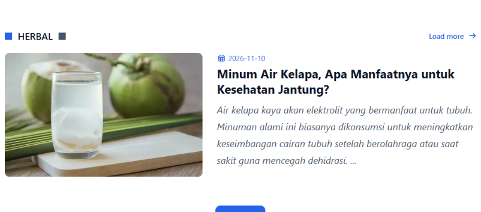

# Next.js Beauty Theme for Blogging

This Next.js theme uses 100% custom CSS written entirely by myself, with no external CSS framework assistance like Tailwind CSS or Bootstrap CSS. I simply prefer building my own designs—not because my design is inherently better than theirs, but because I want absolute creative freedom over the styling structure, lightweight performance, and the pure enjoyment of crafting every single line of CSS from scratch.

## Progres this Project Theme
- [x] Main Theme
    - [x] Header
    - [x] Home Page
        - [x] Slider
        - [x] Theme One
        - [x] Theme Two
        - [x] Theme Three
        - [x] Theme Four
    - [x] Footer
    - [x] Error Page
- [x] Posts
    - [x] List posts perpage
    - [x] Post by category
    - [x] Single Post
        - [x] Main Post
        - [x] Sidebar
        - [x] Related Post
- [x] Web Pages
- [x] Standar SEO Website
    - [x] SEO Home Page
    - [x] SEO Single Post
    - [x] SEO Web Page
    - [x] SEO Category
    - [x] Sitemap Generator

## Creating Posts or Pages

For Windows users, simply double-click the **`create.bat`** file. 
* Choose **`1`** if you want to create a new post.
* Choose **`2`** if you want to create a WebPage (such as *About Us*, *Disclaimer*, etc.).
Follow the on-screen prompts to complete the process.

* **Posts directory**: Saved in the `posts/` folder.
* **Pages directory**: Saved in the `pages/` folder.

## Theme Documentation & Configuration

### 1. Site Configuration
All global configuration settings for your blog (such as the base URL, site title, description, and author details) are managed inside the configuration file:

```markdown
|-- config
    |- sites.md
```

To customize the layout and fetch articles dynamically for your homepage, open and edit the main page file:

``` markdown
|-- app
    |-- page.tsx
```

You can customize the number of posts and target specific categories by modifying the helper functions in the code block below:

``` javascript
// Display 3 latest posts in the hero slider
<Slider dataSlider={getPostsLimit(3)} />

// Display 7 posts for the 'Kesehatan' category in Theme One
<ThemeOne category={getPostsByCategory('Kesehatan', 7)} />

// Display 8 posts for the 'hidup-sehat' category in Theme Two
<ThemeTwo category={getPostsByCategory('hidup-sehat', 8)} />

// Display 8 posts for the 'Keluarga' category in Theme Three
<ThemeThree category={getPostsByCategory('Keluarga', 8)} />

// Display 8 posts for the 'Herbal' category in Theme Four
<ThemeFour category={getPostsByCategory('Herbal', 8)} />
```

Example:

#### Theme One



#### Theme Two



#### Theme Three



#### Theme Four



If you need any help or encounter issues, feel free to contact me:

- Email: [akbarsilohon@gmail.com](mailto:akbarsilohon@gmail.com)
- Telegram: [Silohon Official](https://t.me/silohon94)